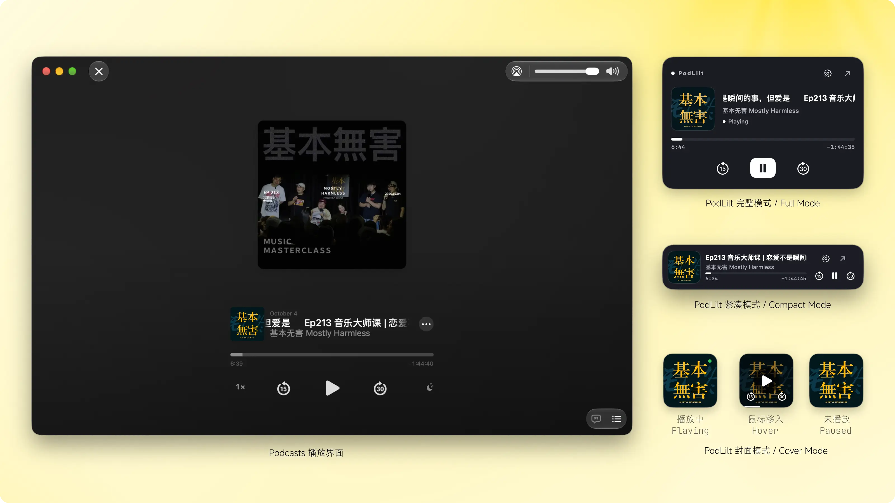

# PodLilt

**English** | [简体中文](README_CN.md)

PodLilt is a lightweight floating podcast player for macOS that displays and controls what is currently playing in **Apple Podcasts**. It stays above other windows and offers Full, Compact, and Cover display modes.



## Features

- Displays episode artwork, title, show name, playback state, current progress, and remaining time.
- Supports play/pause, skip back 15 seconds, and skip forward 30 seconds.
- Offers Full Mode, Compact Mode, and Cover Mode, switchable from the player settings or menu bar.
- Seamlessly scrolls long episode titles to the left in Full and Compact modes, pausing for two seconds after each cycle.
- Shows a green status dot while playing in Cover Mode; hovering reveals playback controls and progress along the bottom edge.
- Supports direct window dragging and automatically keeps the player within the visible screen area.
- Remembers the selected window mode, window position, and language preference.
- Provides menu bar actions to show or hide the player, open Podcasts, switch modes and languages, view About information, and quit the app.
- Supports Simplified Chinese, Traditional Chinese, English, and Japanese. It follows the macOS system language by default, allows manual override, and falls back to English when the system language is unsupported.
- Preserves the original language of podcast show names, descriptions, and episode titles.

## Player Modes

| Mode | Size | Description |
| --- | --- | --- |
| Full Mode | 360 × 236 | Displays complete playback information, progress, and controls. |
| Compact Mode | 360 × 80 | Keeps complete playback information and controls in a single-row layout. |
| Cover Mode | 96 × 96 | Shows only the artwork by default; hovering reveals play, skip, and progress controls. |

## Requirements

- macOS 14.0 or later
- Apple Podcasts
- Xcode installed at `/Applications/Xcode.app` when building from source

## Build and Run

After cloning the repository, run the following commands from the project root:

```sh
./scripts/build.sh
open "dist/PodLilt.app"
```

The build script will:

1. Compile and sign MediaRemote Adapter.
2. Build the `PodLilt` executable in Release configuration.
3. Generate the application icon and assemble `dist/PodLilt.app`.
4. Apply a local ad-hoc signature to the final application.

If Xcode has not completed its initial setup or its updated license has not been accepted, follow the instructions shown in Terminal before running the build script again.

## Accessibility Permission

PodLilt needs access to the Apple Podcasts accessibility controls to read playback information and perform playback actions.

On first launch:

1. Click “Enable Accessibility Permission” in the player.
2. Allow **PodLilt** under “System Settings → Privacy & Security → Accessibility.”
3. Return to Podcasts, pause the current episode, and resume playback once.

After permission is granted, the Podcasts window can remain in the background. If another music player takes over the system media session, PodLilt may temporarily be unable to control Podcasts. Pause and resume playback once in Podcasts to restore control.

## Data and Privacy

- PodLilt only reads and controls Apple Podcasts with the Bundle Identifier `com.apple.podcasts`; it does not control other media players.
- Playback information is retrieved through MediaRemote Adapter when available and from the Podcasts accessibility controls when needed.
- If the system does not provide artwork or duration, PodLilt queries the Apple iTunes Search API using the episode title and downloads matching artwork.
- Apart from the Apple service requests described above, PodLilt does not upload, collect, or store podcast playback data.
- Window mode, window position, and language preferences are stored locally in `UserDefaults`.

## Project Structure

```text
PodLilt
├── Sources/PodLilt          # Application source code
│   └── Localization         # Localized interface strings
├── Resources                # Application icon resources
├── Vendor                   # MediaRemote Adapter
├── assets                   # README image assets
├── scripts/build.sh         # Build and packaging script
├── AppInfo.plist            # macOS application configuration
└── Package.swift            # Swift Package configuration
```

## Known Limitations

- MediaRemote Adapter relies on private macOS APIs, so this project is not suitable as a direct foundation for a Mac App Store release.
- The Apple Podcasts accessibility hierarchy may change in future macOS updates.
- The Apple iTunes Search API may not find artwork or duration for every episode. Missing artwork is replaced with a placeholder, and unavailable duration is shown as `--:--`.

## License

PodLilt is open source under the [MIT License](LICENSE.txt). Copyright © 2026 diandian.

`Vendor/MediaRemoteAdapter` uses the BSD 3-Clause license from [MediaRemote Adapter](https://github.com/ungive/mediaremote-adapter). Its license text is included in the source directory and the built application bundle.

## Feedback and Contact

- Email: [support@podlilt.com](mailto:support@podlilt.com)
- Twitter (X): [@callmediandian](https://x.com/callmediandian)
- GitHub: [cndiandian/PodLilt](https://github.com/cndiandian/PodLilt)
